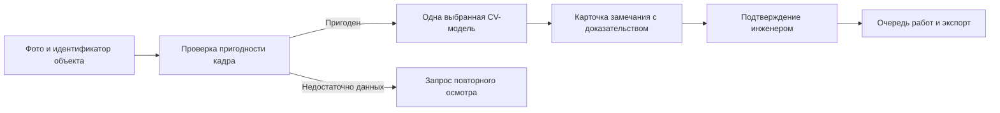

Рабочий анализ кейса МГТС «Сетевой сервис»

Дата: 15 ноября 2026 года. Версия: первоначальный подход до получения полного задания.

Исходные условия команды: три ML-специалиста с коммерческим опытом 7, 3 и 1 год. Подробного задания и данных у команды пока нет. Все предложения о конкретных объектах, дефектах и интерфейсе ниже — гипотезы команды, которые нужно сверить с условиями финала.

**Рекомендуемая концепция — помощник инженера по визуальной инспекции инфраструктуры.** Сервис получает фото осмотра, выделяет наблюдаемые признаки дефектов, показывает основания для вывода и формирует очередь объектов для проверки. Первый прототип охватывает один тип объектов и один-два вида дефектов. Выбор объекта окончательно определяется данными МГТС.

**Что подтверждено организатором.** На официальном сайте требуется прототип автоматического анализа состояния инфраструктуры с выявлением участков для проверки или ремонта. Полную постановку и данные выдадут на финале 26 ноября. Квалификационный ответ подаётся до 19 ноября. Источник: [сайт чемпионата](https://studchamp.mgts.ru/).

По положению: квалификация — общий текст до 2 000 знаков без пробелов; основная работа в финале — до трёх часов. В финальной оценке учитываются соответствие кейсу (20%), техническое обоснование (25%), реализуемость (20%), измеримость эффекта (20%), защита (15%). Источник: [положение, разделы 7, 10, 11](https://studchamp.mgts.ru/assets/files/polozhenie-kod-goroda.pdf).

Из этого следует наша стратегия: сейчас подготовить понимание процесса, варианты алгоритма и способ оценки. Возможность использовать заранее подготовленные код, веса и демонстрационные материалы следует уточнить у организаторов. План финального дня должен работать и без собственного дообучения большой модели.

**Что пока неизвестно и определяет решение.**

| Неизвестное | Почему меняет подход |
|---|---|
| Тип инфраструктуры | Для шкафов, колодцев, кабельных каналов и стоек нужны разные признаки дефектов |
| Источник наблюдений | Фото обхода, стационарная камера и инспекционное видео дают разную частоту и качество контроля |
| Формат разметки | Метки снимка позволяют классификацию, рамки — детекцию, маски — сегментацию |
| Число нормальных и дефектных примеров | Определяет возможность обучения по классам или применения поиска аномалий |
| Идентификаторы объектов и время съёмки | Нужны для истории, устранения повторных тревог и независимой проверки качества |
| Регламент осмотра и ремонта | Определяет, что считать дефектом и какое действие рекомендовать |
| Доступные вычисления и интернет | Определяют допустимую модель и способ запуска |
| Формат результата и ограничения | Может требоваться ноутбук, прототип, API, аналитическая концепция или их сочетание |

На публичных страницах не указан конкретный перечень объектов и классов дефектов. Нельзя представлять предложенные ниже классы как обязательное ТЗ.

**Бизнес-задача — ускорить принятие решения после осмотра.** Предполагаемая цепочка работы: сотрудник получает снимки → специалист просматривает их → определяет проблему и объект → назначает проверку → фиксирует результат. Боль, которую нужно подтвердить с экспертом: сколько времени занимает просмотр, какие проблемы пропускают и сколько ложных тревог допустимо.

Пользователи прототипа:

- Инженер эксплуатации: быстро проверить вывод модели по фото и подтвердить замечание.
- Диспетчер или руководитель: увидеть очередь объектов с понятными основаниями приоритета.
- Сотрудник на осмотре: понять, достаточен ли снимок или требуется переснять объект.

Наблюдение камерой и диагностика сети дополняют друг друга. Видимое повреждение корпуса ещё не доказывает отказ связи, а работающая связь не подтверждает физическую исправность корпуса. По обычной фотографии нельзя достоверно определить скрытый обрыв волокна, затухание, перегрев без соответствующих измерений или срок до аварии. Для таких задач потребуются другие данные.

**Идеи для реализации и условия их выбора.**

| Идея | Что анализирует сервис | Сильная сторона | Основное ограничение | Решение для команды |
|---|---|---|---|---|
| Визуальная инспекция шкафов и распределительных коробок | Незакрытая или отсутствующая дверца, видимое разрушение корпуса | Понятный пользователю результат, удобно показать на фото | Открытая дверца может быть штатным обслуживанием; нужны правила и примеры | Основная рабочая гипотеза при наличии таких данных |
| Инспекция колодцев и кабельных каналов | Видимая вода, мусор, нарушения целостности на инспекционных кадрах | Непосредственная связь с состоянием линейной инфраструктуры | Ракурс, освещение, закрытые участки; необходимы профильные критерии | Предпочесть, если организатор даст соответствующие материалы |
| Контроль качества монтажа по фотоотчётам | Соблюдение конкретного чек-листа, наличие обязательных компонентов | Можно сразу встроить в приёмку работ | Без эталонного чек-листа модель не знает, что считать нарушением | Сильная альтернатива при наличии регламента |
| Поиск изменений «раньше / сейчас» | Новые повреждения и исчезнувшие детали | Понятное визуальное обоснование | Нужны фото одного объекта, сопоставимые ракурсы и выравнивание | Дополнительная функция при наличии истории |
| Непрерывный видеоконтроль помещений или шкафов | Повторяющиеся видимые события | Можно учитывать длительность события | Появляются видеопотоки, повторы, временные правила и вопросы установки камер | Только если видео прямо входит в кейс |
| Прогноз отказа и влияние на абонентов | История дефектов, телеметрия, отказы и топология | Потенциально высокая ценность для эксплуатации | По одним фото нельзя проверить прогноз и влияние | Следующий этап при доступности необходимых данных |

Начинать лучше с существующего потока осмотров: фотоотчётов, инспекционного видео или доступных камер. Предложение установить камеры на все объекты требует отдельного обоснования затрат и не должно быть исходной предпосылкой.

**Предлагаемый MVP: «Сетевой инспектор».**

Первый сценарий, если доступны фото шкафов:

1. Инженер загружает снимки и указывает идентификатор объекта. Координаты и время берутся из реестра или метаданных, если они есть.
2. Система проверяет, можно ли оценить объект: он виден, занимает достаточную часть кадра, не закрыт препятствием и не слишком размыт.
3. Модель определяет состояние по согласованным классам: например, незакрытая/отсутствующая дверца и видимое повреждение корпуса.
4. Интерфейс показывает исходный снимок, класс, рамку или карту аномалии, если метод действительно их выдаёт, и оценку модели.
5. Инженер подтверждает замечание, отклоняет его или запрашивает повторный осмотр.
6. Подтверждённое замечание попадает в очередь работ с кратким описанием и ссылкой на доказательство.

Для кадров без обнаруженных проблем корректная подпись: «На снимке не выявлены признаки из проверяемого списка». Для непригодного кадра: «Недостаточно данных для оценки». Эти состояния должны различаться.

Система помогает определить необходимость проверки. Автоматическое решение о ремонте в MVP не требуется: его подтверждает специалист по регламенту. Открытая дверь при зарегистрированных работах — отдельный контекст, который может изменить приоритет.

**Что должно входить в первую версию.**

- Один тип инфраструктуры и один-два проверяемых дефекта.
- Загрузка одного снимка и небольшой серии.
- Результат с визуальным основанием и явным отказом от вывода при недостатке данных.
- Таблица замечаний: объект, время, наблюдаемый признак, статус проверки.
- Подтверждение или отклонение инженером.
- Экспорт результатов в CSV/JSON.
- Краткая оценка на отложенной выборке и несколько разобранных ошибок.

Карта полезна при наличии реальных координат, история — при повторных осмотрах, интеграция с системой заявок — при наличии требований к ней. Для первой демонстрации достаточно таблицы и карточки замечания. Отдельный чат, 3D-модель инфраструктуры и сложная микросервисная схема не повышают качество исходной диагностики.

**Выбор ML-подхода нужно делать после просмотра данных.**

| Какие данные выданы | Первый кандидат | Что нужно проверить |
|---|---|---|
| Снимки или вырезки с метками состояния | Классификатор на предобученных признаках либо короткое дообучение небольшой модели | Качество на новых объектах и устойчивость к фону |
| Снимки с рамками дефектов | Небольшой детектор, например YOLO | Полноту по каждому дефекту и ложные срабатывания |
| Есть маски и задача требует точной области повреждения | Сегментационная модель | Оправдывает ли дополнительная сложность ценность маски |
| Преимущественно нормальные изображения однотипных объектов | PatchCore как кандидат для поиска аномалий | Не реагирует ли модель на ракурс, фон и освещение вместо дефекта |
| Очень мало разметки, много визуально разных объектов | Быстрый эксперимент с мультимодальной моделью и примерами | Реальные ошибки на кейсе; нельзя полагаться на словесную уверенность модели |
| Есть пары снимков одного объекта | Выравнивание изображений и поиск значимых изменений | Не приняты ли тени, погода или новый ракурс за повреждение |

Детектор возвращает классы и рамки объектов; возможность переноса и дообучения описана в [официальной документации Ultralytics](https://docs.ultralytics.com/tasks/detect/). Наличие общих предобученных весов не означает, что они уже распознают нужные дефекты телеком-объектов.

PatchCore сравнивает признаки участков изображения с банком признаков нормальных примеров; реализация доступна в [Anomalib](https://anomalib.readthedocs.io/en/lib-v2.7.0/markdown/guides/reference/models/image/patchcore.html), исходный метод — в [репозитории авторов](https://github.com/amazon-science/patchcore-inspection). Такой подход выдаёт аномальность, но сам по себе не устанавливает техническую причину повреждения.

Для вашей команды разумно заранее изучить две ветки: классификацию/детекцию известных состояний и поиск аномалий по нормальным примерам. На финале выбрать одну по данным. Объединение нескольких моделей имеет смысл только после сравнения и при наличии времени.

Мультимодальную модель можно испытать как вспомогательный инструмент для чернового описания замечаний. Обязательна ручная проверка. Для типовых замечаний на первом этапе достаточно шаблона на основе проверенного класса. Число confidence из модели нельзя автоматически считать вероятностью реального дефекта или вероятностью аварии.

**Минимальная архитектура.**

Предлагаемый стек прототипа: Python, выбранная ML-библиотека, Streamlit для интерфейса, CSV/SQLite для результатов. Отдельный FastAPI нужен, если условия потребуют API или появится независимый клиент. Очереди задач и производственная инфраструктура пока не обязательны.

Минимальная структура результата: `asset_id`, `inspection_id`, `captured_at`, `image_id`, `finding_type`, `region`, `model_score`, `review_status`, `recommended_action`, `model_version`. Неизвестные время, критичность и координаты остаются неизвестными. Географию или количество затронутых абонентов нельзя восстанавливать из догадок модели.

Подозрения объединяются по объекту и виду замечания. Пять похожих кадров одного дефекта не должны создавать пять заявок. Приоритет определяется согласованной серьёзностью признака, известной критичностью объекта и давностью замечания. Уверенность модели показывается отдельно; сомнительные результаты направляются на проверку.

**Данные — главный фактор реализуемости.**

Сначала нужен небольшой аудит, а не обучение. Проверить: число независимых объектов, источники фото, долю дефектов, видимость признаков, дубли, баланс классов и соответствие разметки регламенту. Составить короткую инструкцию с примерами «дефект / норма / невозможно оценить».

В разметке полезно разделить два вопроса: «какой признак виден?» и «какое действие требуется по регламенту?». Наблюдаемая открытая дверца и требование срочного выезда — разные утверждения.

При разделении выборки все ракурсы и близкие кадры одного физического объекта должны оставаться в одной части. Для видео разделять нужно как минимум по осмотрам или исходным роликам; для проверки переноса на новые места — по объектам. Иначе соседние кадры в обучении и тесте завысят оценку.

Наиболее полезные отрицательные примеры: исправные объекты другого цвета, тени, наклейки, штатное обслуживание, фоновые конструкции, частичные перекрытия. Если их нет, модель может выучить фон или условия съёмки вместо дефекта.

Если данных до финала нет, можно проверить технический процесс на законно доступных учебных материалах. Например, [MVTec AD](https://www.mvtec.com/research-teaching/datasets/mvtec-ad) содержит нормальные и дефектные промышленные изображения с разметкой. Это проверка метода на другом домене; результат на нём не является результатом для МГТС. У набора есть условия некоммерческого использования. Синтетические повреждения также подходят для отладки интерфейса, но не доказывают качество на реальных осмотрах.

**Как доказать качество.**

Основная единица результата — подтверждённое замечание на объекте, а не число обработанных кадров. Выбор метрик должен соответствовать окончательному заданию.

| Показатель | Что показывает |
|---|---|
| Recall по каждому виду дефекта | Какую долю известных реальных проблем обнаружили |
| Precision замечаний после объединения повторов | Какая доля тревог соответствует реальным проблемам |
| Ложные замечания на 100 осмотренных объектов | Насколько велика дополнительная нагрузка на инженера |
| Доля случаев «недостаточно данных» | Как часто система не может сделать полезный вывод |
| Полнота с учётом отказов от вывода | Не спрятаны ли пропуски в категории неопределённости |
| Время просмотра серии с системой и без неё | Помогает ли сервис в реальном процессе |
| Задержка обработки на доступном устройстве | Можно ли пользоваться выбранной моделью в условиях кейса |

mAP или AUROC уместны как технические метрики выбранного метода, но их недостаточно для вывода об эксплуатационной ценности. Порог выбирать на validation по допустимой нагрузке и цене пропуска; test использовать для итоговой проверки. На маленькой выборке показать абсолютные числа TP/FP/FN, размер выборки и ограничения переноса.

Для демонстрации подготовить нормальный кадр, явный дефект, сложный случай и непригодный снимок. Отдельно показать ошибку модели и путь её исправления инженером. Демонстрационные примеры нельзя выдавать за независимый тест качества.

**Как обосновать пользу без выдуманных процентов.**

Первая проверяемая гипотеза: инженер тратит меньше времени на просмотр осмотров при приемлемой полноте обнаружения. Сравнить работу специалиста с сервисом и без него на сопоставимых наборах; учитывать время проверки ложных замечаний и повторной съёмки. Одинаковые снимки при повторном просмотре могут дать эффект запоминания, поэтому порядок и наборы нужно продумать.

Расчёт для пилота:

`эффект от просмотра = N × (время вручную − время с помощником) × стоимость часа − затраты на обработку и сопровождение`

Время выражается в часах, N — число сопоставимых осмотров. Время с помощником включает ручную проверку результатов. Сокращение повторных выездов и предотвращённые аварии считать отдельно, если это подтверждено данными. Экономия на просмотре фото не означает автоматическую экономию на самих обходах.

Пилотное внедрение: сначала работа параллельно штатному процессу без автоматического назначения ремонта, затем разбор ошибок с инженером, настройка порогов и только после этого интеграция в очередь работ.

**Что уже существует и как сформулировать отличие.**

У [Nokia Broadband Easy](https://www.nokia.com/broadband-access/services/broadband-easy/) компьютерное зрение используется для контроля качества полевых работ и приёмки инфраструктуры. [Ericsson Intelligent Site Engineering](https://www.ericsson.com/en/network-services/deployment/intelligent-site-engineering) объединяет визуальные данные, распознавание инфраструктуры и цифровые модели площадок.

Эти примеры подтверждают применимость класса решений в телекоме. Для проекта лучше заявлять конкретное отличие, которое можно показать: адаптация к одному сценарию МГТС, прозрачное доказательство замечания, работа с непригодными снимками, отсутствие повторных заявок и измеримый эффект для инженера. Нельзя обещать уникальность самой идеи «ИИ смотрит на оборудование».

**Распределение работы для трёх ML-специалистов.**

| Роль | Зона ответственности | Результат |
|---|---|---|
| Ведущий по решению и предметной области | Уточняет критерии дефекта, выбирает метод и отвечает за границы выводов | Согласованный сценарий и техническое обоснование |
| Ведущий по данным и оценке | Аудит, разбиение выборки, baseline, ошибки и пороги | Проверяемые результаты и ограничения |
| Ведущий по демонстрации | Интерфейс, запуск модели, карточки замечаний, экспорт и сценарий показа | Воспроизводимый проход от фото до решения инженера |

Назначить роли по сильным сторонам участников; стаж сам по себе не определяет распределение. При трёх ML-специалистах особенно важно явно закрепить ответственность за процесс эксплуатации, интерфейс и защиту: эти части не появятся автоматически после обучения модели.

**План подготовки до финала.**

- К квалификации: согласовать формулировку проблемы, рабочую гипотезу, критерии успеха и вклад каждого участника. Адаптировать отдельный черновик ответа под реальные мотивацию и компетенции.
- До определения финалистов: разобрать доступные записи профильных вебинаров; получить ответы на вопросы об объектах, данных и правилах подготовки; изучить подходы к классификации/детекции и аномалиям.
- При разрешённой предварительной технической подготовке: проверить окружение, веса, загрузку данных, измерение качества и простую визуализацию на учебном примере. Отдельно проверить доступные устройства и работу без скачивания зависимостей во время показа.
- После организационных уточнений: адаптировать план к фактическим формату сдачи, ресурсам и времени защиты.

**Предлагаемое распределение трёх часов основной работы.** Это план команды, а не расписание организатора.

| Время | Действие | Условие завершения |
|---|---|---|
| 0–20 минут | Прочитать кейс, посмотреть данные, уточнить дефекты, ресурсы и формат результата | Один проверяемый сценарий и выбранный метод |
| 20–60 минут | Получить первый результат модели и провести первичную оценку; параллельно собрать показ | Примеры вывода и список основных ошибок |
| 60–110 минут | Сделать одно полезное улучшение, настроить вывод и ручную проверку | Работает весь путь от данных до замечания |
| 110–145 минут | Зафиксировать метрики, разобрать ограничения, подготовить аргументацию эффекта | Числа с понятной методикой и честными границами |
| 145–180 минут | Собрать защиту, проверить запуск, отрепетировать и подготовить резерв показа | Решение воспроизводится, каждый участник знает свою часть |

Если первые результаты показывают, что выбранный метод не подходит данным, сузить классы или сменить ветку один раз. Не тратить финальный час на новую архитектуру без оценки. Если условия требуют другого результата, приоритет имеет фактическое задание.

**Вопросы экспертам МГТС, в порядке влияния на решение.**

1. Какой конкретно объект и какое решение инженера нужно автоматизировать?
2. Откуда поступают изображения и как часто обновляются? Есть ли уже работающий фотоотчёт?
3. Какие признаки считаются дефектами, какие — допустимым состоянием? Есть ли инструкция и примеры?
4. Как устроен набор: количество объектов, изображения/видео, классы, разметка, история, идентификаторы?
5. Что дороже в целевом процессе: пропуск конкретного дефекта или ложное замечание? Каков допустимый объём ручной проверки?
6. Требуется ли находить проблему на кадре или достаточно определить состояние объекта?
7. Какие вычисления и доступ к интернету будут на финале? Допустимы ли внешние сервисы, предобученные веса и заранее подготовленные заготовки?
8. Что именно нужно сдать и показать? Есть ли дополнительные технические метрики и скрытая тестовая выборка?
9. Есть ли реестр объектов, критичность, действующие заявки и сведения о плановых работах?

**Основа короткой защиты.** «Мы помогаем инженеру находить видимые признаки проблем на материалах осмотра. Для выданного типа объектов проверяем конкретный список состояний. Каждое замечание связано со снимком, непригодные материалы требуют повторного осмотра, решение о действии подтверждает инженер. Качество проверяем на независимых объектах, пользу — временем просмотра и нагрузкой от ложных тревог».

Готовность к финалу означает, что команда может обосновать выбор метода, быстро получить первый результат на новых данных и объяснить, что он доказывает. Конкретную специализацию сервиса следует зафиксировать после получения подробного кейса.
