# Архитектура прототипа

## Поток

```mermaid
flowchart LR
    A[Снимки + данные CSV / Excel<br/>ID, время, координаты, рамка] --> L[Локализация<br/>готовая рамка или YOLO26n]
    L --> B[Проверка кадра<br/>резкость, свет, масштаб]
    B -->|недостаточно данных| R[Карточка «нужен другой кадр»<br/>причина + исходник]
    B -->|пригоден| C[Кроп объекта<br/>bbox или весь кадр]
    C --> D[Признаки DINOv2 и CV]
    D --> E[Классификатор состояний<br/>p_finding + класс]
    E --> F[Порог и статус<br/>finding / uncertain / normal]
    F -->|опционально для сложного кадра| V[Перепроверка Gemini 4 Argon через Vertex AI]
    F --> G[Привязка к реестру и группировка по объекту]
    V --> G
    G --> H[Очередь карточек]
    H --> I[Мастер: подтвердить /<br/>отклонить / запросить кадр]
    I --> J[SQLite + экспорт CSV / JSON / GeoJSON]
```



## Базовые решения и их обоснование

| Решение | Почему | Что проверить |
|---|---|---|
| Один тип объекта (колодец) и один видимый признак | Укладывается в 3 часа и даёт честную карточку | Финальное ТЗ может требовать несколько классов |
| `hybrid` (MobileNetV3 + classical-CV) с логистической регрессией; чистые CNN и CV — как сравнение | Веса готовы, CPU-инференс, не переобучается на сотнях кадров; явные признаки добавляют устойчивость | Реальная различимость признака на масштабе |
| Без дообучения backbone | Нет GPU и времени; меньше риск переобучения на фон | Если данных много, fine-tune может дать прирост |
| OOF по `asset_id` | Кадры одного объекта похожи; случайное разбиение завышает качество | Достаточно ли независимых объектов у МГТС |
| Группировка кадров в карточку | Пять фото одного люка не должны создавать пять задач | Правила ID и повторных визитов |
| Явный отказ по качеству | Размытый кадр нельзя превращать в замечание или в «норму» | Перекрытие автомобилем эвристика не ловит |
| Порог как продуктовый выбор | Цена пропуска и ложной тревоги разная; нужен диалог с эксплуатацией | Приемлемая нагрузка мастера |
| Локальный запуск | Нет зависимости от интернета и внешних API на финале | Правила передачи изображений |
| Baseline на классических признаках | Жюри просит сравнение с простым методом | Насколько CNN реально лучше на целевых данных |

## Модули

| Файл | Ответственность |
|---|---|
| `inspector/manifest.py` | Контракт `manifest.csv`, bbox, ID, координаты, fingerprint |
| `inspector/quality.py` | Проверка кадра и кроп; `Quality` с причинами отказа |
| `inspector/features.py` | `TorchEmbedder` (MobileNetV3) и `ClassicalEmbedder` |
| `inspector/classifier.py` | Обучение, GroupKFold OOF, порог, сохранение/загрузка, аномалии |
| `inspector/pipeline.py` | Инференс пачки, статусы, группировка, копирование медиа, summary |
| `build_cards` в `pipeline.py` | Одна карточка на `(asset_id, признак)`, история кадров, приоритет |
| `inspector/evaluate.py` | Метрики на уровне объектов, отчёт `eval.md` |
| `inspector/store.py` | Решения мастера в SQLite, экспорт |
| `inspector/web.py` | FastAPI: очередь, медиа, решения, загрузка нового кадра, экспорт |
| `inspector/static/` | Интерфейс без сборки: очередь, карточка, порог, модалка загрузки |
| `inspector/synth.py` | Синтетический стенд и контактный лист |
| `inspector/cli.py` | `synth`, `train`, `evaluate`, `run`, `serve`, `demo` |

## Артефакты прогона

```
runs/public/
  cards.json          все объекты с вычисленным статусом (включая normal для слайдера порога)
  summary.json        сводка, модель, покрытие, время
  observations.csv    аудит по каждому кадру: p, качество, статус
  images/             исходные кадры для интерфейса
  crops/              фрагменты, поданные модели
  reviews.sqlite3     решения мастера
```

```
artifacts/public/
  model.joblib        scaler + classifier (+ банк аномалий)
  meta.json           классы, порог, CV, fingerprint данных
  thresholds.csv      полнота/точность/FPR для 101 порога от 0 до 1
  oof.csv             out-of-fold прогнозы по кадрам
  eval.json/eval.md   отчёт по объектам (OOF)
  eval_holdout.md     оценка на отложенных фото выбранной задачи
  comparison.json     модель против классического baseline
  baseline/           артефакт baseline
```

## Интерфейс

- **Очередь** — только объекты, требующие внимания; нормальные скрыты, но участвуют в
  слайдере порога.
- **Карточка** — исходный кадр с областью объекта, кроп, наблюдаемый признак, `p`, качество,
  модель, предлагаемое действие, история кадров, кнопки решения.
- **Порог в интерфейсе** даёт предпросмотр по одному выбранному кадру каждой сохранённой карточки. Экспорт и решения мастера привязаны к рабочему порогу. Полную перегруппировку кадров выполняет команда `run --threshold`.
- **Загрузка** — новый файл проходит тот же путь и показывает карточку; в очередь прогона
  не пишется, чтобы не смешивать демонстрацию и пакетный результат.

## Связь с исследованием

Реализует **концепцию № 1** «Очередь замечаний после осмотра»: решение о приоритете
текущего осмотра, а не прогноз аварии. Запасной режим — **№ 10** «выборочная ревизия
необычных состояний» при наличии только нормы. Сравнение двух осмотров (**№ 3**) не
реализовано: для него нужны подтверждённые пары одного ID с сопоставимым ракурсом.

## Что добавлять после финала

1. Расширить детектор YOLO за пределы класса люков по разметке МГТС и проверить поиск объектов на независимых маршрутах.
2. Калибровка `p_finding` (Platt/isotonic) на независимом наборе.
3. История визитов и сравнение до/после для подтверждения устранения.
4. Интеграция с реестром нарядов: открытая крышка при плановых работах не должна
   автоматически повышать приоритет.
5. Пилот: две сопоставимые подборки, время мастера, подтверждённые находки, ложные карточки.
